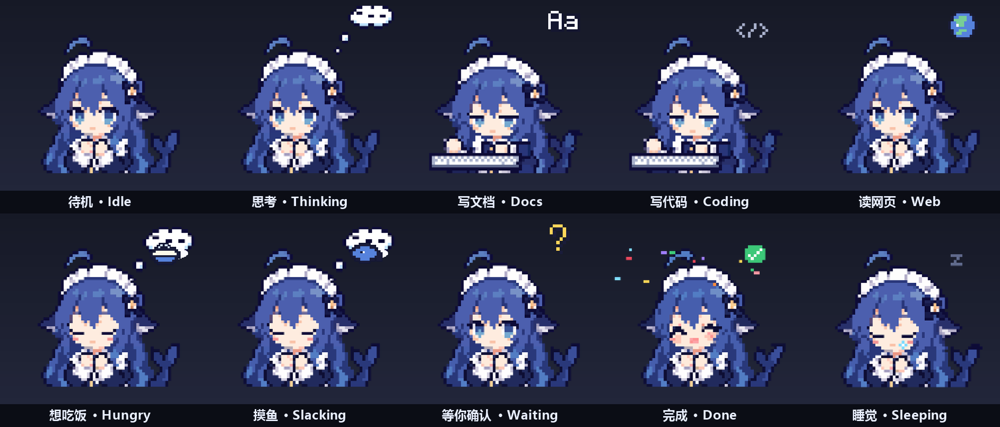

# Blue Fat Fish Desktop Pet

[中文](README.md) · English

A Windows desktop pet for the DSH pixel mascots. It follows the DSH / Claude Code agent states, can switch between Whale Girl / Claude Girl / Codex Girl, and can launch your local agents from the context menu.

## Quick start

Windows 10/11 with PowerShell 5.1 (built in). No extra dependencies.

1. Clone or download this repository
2. Double-click `launch.vbs`
3. (Optional) Run `install-claude-hooks.ps1`, then restart Claude Code to sync its states

## States

| Action | Agent state |
| --- | --- |
| Idle | Nothing running |
| Thinking | Thinking / waiting for the first token |
| Docs | Writing / editing `.md`, `.txt` documents |
| Coding | Using tools / writing code |
| Web | `web_fetch` / `WebSearch` |
| Hungry | Thinking for over 45 seconds, dozing off |
| Slacking | Thinking for over 90 seconds |
| Waiting | The agent needs your confirmation / answer |
| Done | The turn finished |
| Sleeping | Idle for 3 minutes |

DSH states are automatic; Claude Code needs the one-time hooks installer.

## Interactions

- Click left / right: dodge
- Triple-click: ticklish
- Double-click: hearts
- Drag: pick her up; screen edges stop her
- Right-click: launch / change skin / sleep / wake / reset position / quit

## Launch

The context menu item follows the current skin and auto-detects the best local entry:

- Whale Girl: `dst` → DSH web → DSH desktop → `dsh` CLI
- Claude Girl: `claude` CLI → Claude desktop → claude.ai
- Codex Girl: ChatGPT desktop → `codex` CLI → chatgpt.com/codex

## Credits

- Characters and TUI: **dsh-TUI** — https://github.com/ccch1mneyyy/dsh-TUI
- Harness: **DeepSeek Harness** — https://github.com/deepseek-ai/deepseek-harness

Characters and artwork belong to their original authors. This is an unofficial fan project for personal desktop use.