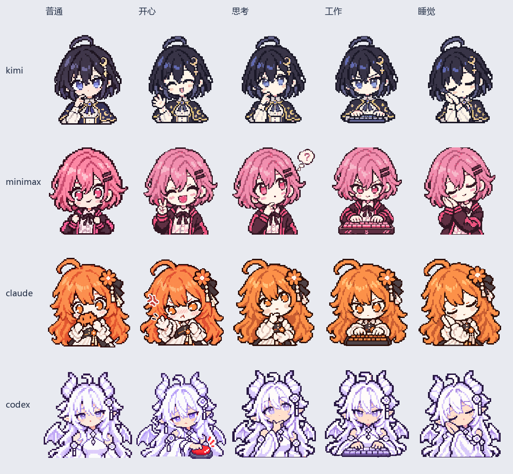
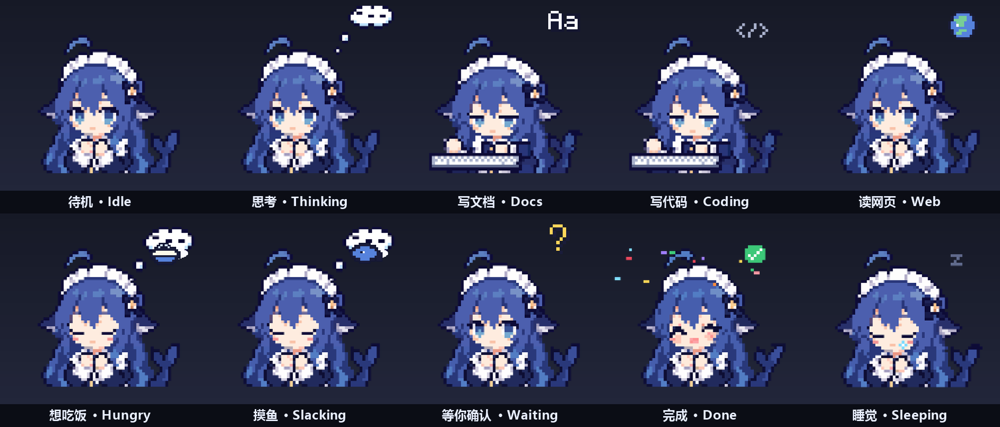

# 大肥鱼桌宠

[English](README.en.md) · 中文

DSH 像素看板娘「鲸娘」的 Windows 桌宠：能跟着 DSH / Claude Code 的工作状态变动作，可以换 Claude 娘 / Codex 娘 / Kimi 娘 / MiniMax 娘，右键还能启动本机的 agent。

## 快速开始

Windows 10 / 11，系统自带 PowerShell 5.1 即可，不需要安装依赖。

1. 克隆或下载本仓库
2. 双击 `launch.vbs`
3. （可选）运行 `install-claude-hooks.ps1`，再重启 Claude Code，让 Claude Code 的状态也同步过来

## 角色

可切换：鲸娘、Claude 娘、Codex 娘、Kimi 娘、MiniMax 娘。静态角色也有自己的思考 / 工作 / 等待 / 睡觉姿势：

## 动作与状态

| 动作 | 表示 agent 的状态 |
| --- | --- |
| 待机 | 没在干活 |
| 思考 | 正在思考 / 等第一个 token |
| 写文档 | 在写 / 改 `.md`、`.txt` 文档 |
| 写代码 | 在调工具、写代码 |
| 读网页 | 在用 `web_fetch` / `WebSearch` |
| 想吃饭 | 思考超过 45 秒，开始打瞌睡 |
| 摸鱼 | 思考超过 90 秒 |
| 等你确认 | agent 需要你确认或回答 |
| 完成 | 这一轮完成 |
| 睡觉 | 3 分钟没人理她 |

DSH 的状态会自动读取；Claude Code 需要跑一次 hooks 安装脚本。静态角色会用各自的姿势图；Qwen 的立绘还在草稿阶段，暂未放进菜单。

## 互动

- 点左边 / 右边：扭头躲
- 连点 3 下：怕痒
- 双击：冒爱心
- 拖动：拎起来；拖到屏幕边缘会被挡住
- 右键：启动 / 换形象 / 动作预览 / 睡一会儿 / 叫醒她 / 回到右下角 / 退出

## 启动

右键「启动」会按当前形象自动挑本机入口：

- 鲸娘：`dst` → 网页版 DSH → 桌面版 DSH → `dsh` CLI
- Claude 娘：`claude` CLI → Claude 桌面版 → claude.ai
- Codex 娘：ChatGPT 桌面版 → `codex` CLI → chatgpt.com/codex
- Kimi 娘：打开 kimi.com
- MiniMax 娘：打开 agent.minimax.io

## 参考项目

- 角色素材与 TUI：**dsh-TUI** — https://github.com/ccch1mneyyy/dsh-TUI
- 底层 harness：**DeepSeek Harness** — https://github.com/deepseek-ai/deepseek-harness

角色与美术版权归原作者；本项目是非官方粉丝作品，仅用于个人桌面装饰。